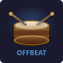

<p align="center">
  
</p>

<h1 align="center">OffBeat</h1>

<p align="center">Buff and rotation tracker for World of Warcraft with shareable, data-driven profiles.</p>

---

## What it does

OffBeat is a single addon framework that tracks buffs on party members **or** your own rotation accuracy - depending on the profile loaded for your spec. Profiles are pure data: no code, just spell IDs and rules. Import and export them like WeakAura strings. It's meant to codify the guide from [method.gg](https://method.gg).

**Buff tracking** (e.g. Augmentation Evoker): countdown bars for party buffs, uptime percentages, Gantt-chart timeline, cast warnings. While the game hides other players' auras in combat, the bars keep what they had and your own casts (Prescience) put the buff on its target for its base duration.

**Rotation tracking** (e.g. Windwalker Monk, Frost DK, Ret Paladin): ability history strip, mistake detection, key cooldown alerts, proc tracking, cast log with export.

**Key Layout**: a settings page that shows which spells deserve your best keys, for single target and AoE, next to your current keybinds.

**Rotation sheet** (Affliction and Destruction Warlock, Frost DK, Augmentation Evoker): a small movable panel with the guide's priority list, one line per spell with its icon and the key it's bound to.

**Training** (e.g. Demonology Warlock): coaching for your big cooldown windows, scored against goals and casts-per-minute benchmarks taken from top Warcraft Logs parses, with a report panel at the end of each session.

A profile can use any combination.

## Included profiles

| Addon | Spec | Type |
|-------|------|------|
| OffBeat_Evoker | Augmentation Evoker | Buff tracking, Rotation (Eruption / empowers / Breath of Eons inside Ebon Might), Breath of Eons countdown (Fire Breath, Upheaval ready), Key Layout; Training (Breath of Eons: Fire Breath + Upheaval) |
| OffBeat_Monk | Windwalker Monk | Rotation (Combo Strikes) |
| OffBeat_DeathKnight | Blood Death Knight | Rotation (Bone Shield, DRW, Crimson Scourge, Boiling Point), Key Layout; Training (Frost, Unholy) |
| OffBeat_DeathKnight | Frost Death Knight | Rotation (Rime, Breath with Pillar), Pillar countdown (runes, Runic Power), Key Layout; Training (Pillar of Frost: runes pooled, Obliterate / Frostscythe) |
| OffBeat_DeathKnight | Unholy Death Knight | Rotation (Dark Transformation, Sudden Doom), Key Layout |
| OffBeat_Paladin | Retribution Paladin | Rotation (Art of War, Empyrean Power) |
| OffBeat_DemonHunter | Havoc, Vengeance, Devourer | Rotation & Tank Cooldowns |
| OffBeat_Shaman | Elemental, Enhancement | Rotation & Maelstrom Spenders |
| OffBeat_Warlock | Affliction, Demonology, Destruction | Rotation, Pet Spenders & Demonic Art / Fiendish Cruelty procs, Key Layout, pet warnings; Training (Affliction, Demonology, Destruction) |
| OffBeat_Mage | Arcane | Rotation & Burn Phases |
| OffBeat_Priest | Discipline, Holy | Key Layout, Surge of Light, healer cooldowns |

## Stat priority

The stat priority panel has moved to its own addon, **[Statisfaction](https://github.com/alde/statisfaction)**. OffBeat profiles can still set `statPriority` / `heroStatPriorities`; when Statisfaction is installed it uses them over its built-in table.

## Installation

Install **OffBeat** (the core) plus whichever `OffBeat_<Class>` addons you need. Each class addon must be its own folder in `Interface/AddOns/` - the CurseForge packager handles this automatically via `move-folders`.

**From source** (development): clone the repo into your AddOns directory, then symlink the satellites so WoW can find them:

```bash
cd Interface/AddOns/OffBeat
./dev_install.sh        # macOS/Linux
.\dev_install.ps1       # Windows (creates junctions)
```

Panels ignore the mouse while OffBeat is locked, so clicks and camera drags go through to the world; their own buttons (close, `<` `>`) still work. Unlock to move them, or hold Shift and drag one while locked (out of combat only, so Shift keybinds in combat don't grab panels). The training report is the exception: it only opens when you ask for it, so it always takes clicks and can be dragged.

## Commands

| Command | Action |
|---------|--------|
| `/ob` | Open settings |
| `/ob show` | Toggle display panel |
| `/ob timeline` | Toggle timeline |
| `/ob lock` | Lock/unlock frames |
| `/ob profile <name>` | Switch profile |
| `/ob test` | Inject test data |
| `/ob training` | Toggle cooldown window coaching (stays on through /reload) |
| `/ob report` | Show the training report (the session so far while training is on) |
| `/ob bars` | Show this spec's bar layout; `/ob bars apply` puts the spells on your bars (out of combat) |
| `/ob sheet` | Show or hide this spec's rotation cheat sheet |
| `/ob gear` | Check your enchants and gems against what top players of your spec use |


## Creating a profile

A profile is a Lua table registered with `OffBeat:RegisterProfile({...})`. Create a new `OffBeat_<Class>` addon with a `.toc` that depends on OffBeat, and a single `.lua` file:

```lua
local OffBeat = _G.OffBeat

OffBeat:RegisterProfile({
    meta = {
        name = "My Spec",
        specId = 123,       -- WoW specialization ID
        version = 1,
        author = "You",
    },

    -- Pick the sections you need:

    -- Buff tracking (party buffs)
    trackedBuffs = { { spellId = 12345, name = "Buff", color = {1,1,1}, category = "primary", baseDuration = 10 } },
    alerts = { { type = "missing_buff", spellId = 12345, name = "Buff" } },
    castWarnings = { { castNames = {"Spell"}, requireBuff = 12345, buffName = "Buff" } },

    -- Rotation tracking (personal casts)
    rotationSpells = { { spellId = 11111 }, { spellId = 22222 } },
    mistakes = { { type = "repeat_cast", name = "Mastery Break" } },
    trackedAuras = { { spellId = 99999, name = "Proc", baseDuration = 15 } },
    keyCooldown = { spellId = 99999, name = "Big CD", duration = 20 },
    idleCooldowns = { { spellId = 55555, name = "Cooldown" } },
    procTracking = { { procAura = 99999, consumeSpells = { 11111 }, window = 0.5, name = "Proc" } },

    -- Key Layout page: tier per context, 1 = core, 2 = regular, 3 = cooldown, nil = unused
    keyLayout = { { spellId = 11111, st = 1, aoe = 2, note = "Filler", alt = { 11112 } } },
    keyLayoutLabels = { st = "ST", aoe = "AoE", stLong = "Single Target", aoeLong = "AoE" }, -- optional

    -- Training (see below)
    windows = { { name = "Big CD", trigger = 99999, duration = 20,
                  goals = { { name = "Spender", spells = { 22222 }, min = 6 } } } },
    benchmarks = { source = "top parses", rates = { { name = "Spender", spells = { 22222 } } },
        encounters = { [1234] = { name = "Some Boss", values = { { 10, 11, 12 } } } } },
})
```

Profiles can be exported as `!OB1!` strings from the settings panel and shared in chat or on the web.

## Bar layout

`/ob bars` shows a profile's `barLayout` (which spell goes on which key) and `/ob bars apply` puts them on your bars. An entry can be a macro that picks between spells two builds don't share, so one key works for both: `{ slot = 67, key = "R", macro = { name = "OB Havoc/Cata", spells = { 80240, 152108 } } }` becomes a per-character macro `/cast [known:Havoc] Havoc; Cataclysm`. Add `cursor = true` to cast at the mouse (`[@cursor]`), e.g. `macro = { name = "OB Rain", spells = { 5740 }, cursor = true }`.

## Rotation sheet

Profiles with a `rotationSheet` get a movable cheat sheet panel: sections (e.g. single target, AoE) of lines, each with the spell's icon, your keybind for it (read from your bars, `--` when it isn't on one) and a short instruction. Lines for spells you don't know are hidden.

```lua
rotationSheet = {
    { title = "Single target", lines = {
        { spellId = 445468, alt = { 348 }, text = "Wither: keep it up" },
        { text = "A tip with no spell" },
    } },
}
```

A section can be limited to a talent build or a kind of content: `known = { ids }` shows it only when you know one of those spells, `unknown = { ids }` only when you know none, and `content = "raid"` / `"dungeon"` only in that kind of instance (outside instances every section shows). Destruction uses this for Hellcaller vs Diabolist and raid cleave vs M+ packs.

`/ob sheet` (or the Spec settings page) shows or hides it per spec, and it can hide itself in combat. Drag it while frames are unlocked; locked, it lets clicks through to the world. Filled in for Affliction and Destruction Warlock, Frost Death Knight and Augmentation Evoker.

## Key Layout

Profiles with a `keyLayout` section get a **Key Layout** page in settings (`/ob`). It lists the guide's rotation spells grouped by how often you press them (core, regular, cooldown), marks whether each is used in single target, AoE or both, and shows your current keybind so you can see what's on a bad key: red means a core or regular spell is unbound, amber means a core spell sits behind a modifier. Spells you haven't talented are hidden by default, and hero-tree replacements (Immolate -> Wither) collapse into one row. `alt` lists fallback IDs for spells that have changed ID.

`keyLayoutLabels` renames the two contexts, e.g. `{ st = "Single", aoe = "Group", stLong = "Single Target", aoeLong = "Group Healing" }` for a healer; without it they're ST / AoE.

Currently filled in for all Warlock and Death Knight specs, Augmentation Evoker, and Discipline and Holy Priest.

## Training

Training coaches your big cooldown windows and compares your casting with top players. It's off by default and never saved: `/ob training` (or the toggle on the **Training** settings page) turns it on until you turn it off or log out. A `/reload` keeps it on, along with the session so far.

Only combat counts, and in a raid only boss encounters count (setting on the Training page), so you can leave it on for a whole raid night: trash is ignored, and the report groups the session boss by boss. Outside raids (target dummies) every fight counts. A Mythic+ run counts as one fight: every pull folds into it, its length is time in combat, and the report marks it timed, over time or abandoned (there are no top-parse numbers for dungeons).

How to use it:

1. Turn it on and fight a target dummy (or a boss).
2. When you press the window's cooldown, OffBeat checks your setup (for Demonology: 5 Soul Shards pooled) and a counter shows the casts that matter inside the window against a goal.
3. Each window ends with a scorecard in chat; each fight ends with a summary and your casts per minute against the profile's benchmarks.
4. Turn training off and a **report panel** sums up the session, one page per pull (marked kill or wipe). `<` and `>` step through them, and clicking the page counter lists every pull to jump to. Each page has one bar per window against its goal (with the top players' median for that boss) and one bar per benchmark spell over that boss's top players' middle half. `/ob report` shows the session so far while training is on (opening on the latest pull), otherwise the last report.

Goals can be adjusted per spec on the Training page, so you can start with one you can reach and raise it as you improve.

Training also turns on combat logging for the session (setting on the Training page), so it can be uploaded to Warcraft Logs and compared afterwards. It only turns off a log it started itself, and warns if Advanced Combat Logging is off, which Warcraft Logs needs.

### Windows

Casting `trigger` opens a window for `duration` seconds. `setup` checks are judged when you press the trigger (same conditions as mistake rules); a check the game won't let OffBeat read shows as `?`, never as a miss. `goals` count casts inside the window. `note` is shown on the Training page. If combat ends before the window runs out (the boss dies), the window only counts when you had already reached the goal; otherwise it's left out of the score and shown greyed out as "early".

```lua
windows = { {
    name = "Tyrant", trigger = 265187, duration = 25,
    note = "Pool shards and cores, then spend everything on Hand of Gul'dan.",
    setup = { { name = "5 Soul Shards", when = { power = "SoulShards", min = 5 } } },
    goals = { { name = "Hand of Gul'dan", spells = { 105174 }, min = 8 } },
} }
```

### Benchmarks

Casts per minute from top parses, per boss. `rates` says what is measured; each encounter (keyed by its encounter ID, the boss ID Warcraft Logs uses) lists `{ low, median, high }` per rate, where low/high are the middle half. `window` is the top players' median goal count per window on that boss. `overall` covers fights that aren't a boss encounter, like target dummies. A boss without data gets no comparison rather than another boss's numbers. `all = true` counts every `rotationSpells` cast; a fight reaches a benchmark when your rate is at least `low`.

```lua
benchmarks = {
    source = "top heroic parses per boss",
    rates = {
        { name = "Rotation casts",  all = true },
        { name = "Hand of Gul'dan", spells = { 105174 } },
    },
    encounters = {
        [3492] = { name = "Ula'tek", window = 8, values = { { 40.5, 41.5, 42.7 }, { 12.7, 13.1, 13.6 } } },
    },
    overall = { name = "all heroic bosses", values = { { 42, 44, 46 }, { 13, 14, 15 } } },
}
```

Demonology's goals and benchmarks come from the top Demonology parses for every heroic boss in The Venomous Abyss on Warcraft Logs (October 2026).

### Pet

Specs with a permanent pet (`pet = { quickSummon = 333889 }`) get a warning when the pet dies in combat, when a pull starts without one, and when it drops under 35% health, with a reminder to use the quick-summon spell (Fel Domination) first if you know it. Each can be turned off on the Spec page. While training, every fight's report page shows how many times the pet died and how long you were without one.

### While moving

A profile can list spells that are worth casting on the move (`movingCasts = { { spellId = 264178, name = "Demonbolt" } }`). When you've been moving for 1.5 seconds without casting and one of them is instant and usable right now (Demonbolt with a Demonic Core), OffBeat flashes "Moving: Demonbolt is instant", once per stretch of movement. Delay, sound and on/off are on the Spec page.

### Failed presses

A profile with `failNudges` says what to press instead when a press fails, e.g. Obliterate with no runes:

```lua
failNudges = {
    { error = "runes", spells = { 49020, 207230 }, name = "Obliterate with no runes",
      text = "No runes: Howling Blast on Rime, else Frost Strike" },
    { error = "range", spells = { 49020, 49143 }, name = "Melee out of range",
      text = "Out of range: Howling Blast on Rime, Glacial Advance" },
}
```

`error` is `"runes"` (Not enough runes), `"range"` (Out of range), `"essence"` (Not enough essence) or `"moving"` (Can't do that while moving). The hint flashes in the text warning frame at most every few seconds while you keep pressing, and each stretch of failed presses counts once (as `name`) in the training report. It reads the game's own error message, so it works while combat information is hidden. On/off is on the Spec page.

### Countdown

A profile with `prep` gets a small panel in combat that counts down to its main cooldown and shows what you should be holding when it comes up, green when you have it, red when you don't (? when the game won't say):

```lua
prep = {
    spellId = 51271, name = "Pillar", cooldown = 45, lead = 5,
    hint = "Hold runes: Frost Strike, Obliterate only on Killing Machine",
    checks = {
        { name = "Runes", power = "Runes", min = 3 },
        -- only shown when this cooldown comes up with it (Breath turns)
        { name = "Runic Power", power = "RunicPower", min = 60,
          with = { spellId = 1249658, name = "Breath", cooldown = 90 },
          -- the same press casts Reaper's Mark (+20) first, when it's ready
          credit = { spellId = 439843, amount = 20, cooldown = 45 } },
        -- a spell that should be off cooldown too: green when it will be
        -- ready in time, red with how many seconds late (hidden if unknown)
        { name = "Fire Breath", ready = 357208, cooldown = 30 },
    },
}
```

It shows from `lead` seconds before the spell is ready until you cast it. Time left comes from the cooldown when the game reveals it, otherwise from your last cast plus `cooldown`. On/off and the number of seconds are on the Spec page; unlock frames to move it. Filled in for Frost Death Knight (Pillar of Frost) and Augmentation Evoker (Breath of Eons, with Fire Breath and Upheaval ready).

## Gear

The **Gear** settings page (and `/ob gear`) lists, for every spec, the enchants and gems the top 15 heroic Ula'tek players of that spec use (healers ranked by healing), with how many of them use each, and checks them against what you have on: OK, a different enchant, missing, or empty sockets. The data is in `GearData.lua`, generated from Warcraft Logs.

## Buffs from your casts

Since 12.1 the game hides aura data in combat, your own buffs included. A profile can say how a buff follows from your casts, and OffBeat uses that whenever it can't see the real aura (mistake rules, window setup, cast warnings, the buff panel):

```lua
castAuras = {
    { aura = 395296, cast = 395152, duration = 14, max = 20, grace = 4,   -- Ebon Might
      extend = { { spell = 395160, by = 1.4 }, { spell = 357208, by = 1.5 } } },
}
```

Casting `cast` puts `aura` up for `duration` seconds (a recast while it's up adds to what's left, at most `max` from now); while it's up each `extend` spell adds `by` seconds. It still counts as up for `grace` seconds past the estimate, so a rough estimate can hide a mistake but not invent one. `/ob auradebug` shows what the game reports and what the estimate says.

## Mistake types

| Type | Rule | Example |
|------|------|---------|
| `repeat_cast` | Same spell cast twice in a row | Windwalker mastery break |
| `bad_cast` | One of `spells` cast while every condition in `when` holds | Frost Strike at 2 Killing Machine, Heart Strike at 75+ Runic Power |

`when` is one condition or a list of them (all must hold). Six kinds:

```lua
{ aura = 264173, minStacks = 4 }              -- aura up, optional stack range; absent = true for "not up"
{ power = "RunicPower", min = 75 }            -- Enum.PowerType name or number, min and/or max
{ combat = true }                             -- in or out of combat
{ hardcast = true }                           -- the cast had a cast bar (not instant)
{ moving = false }                            -- standing still when you pressed it
{ recent = 51271, within = 12, absent = true } -- you did (or, absent, didn't) cast this in the last N seconds
```

Conditions are judged when the cast is sent, so costs and consumed procs don't skew the result, and only casts that succeed are counted. A value the game won't reveal (secret) never matches, so it can hide a mistake but never invent one; that includes "aura not up" while the game hides auras. Prefer `hardcast` over "proc aura absent" for instant-on-proc spells: it doesn't depend on reading auras. `recent` is read from your own casts and judged when the cast completes, so it also works while auras are hidden, and the earlier spells of a macro have counted by then (Frost: "Breath without Pillar").

With training on, each pull's mistakes are counted and shown on the training report page (and in the chat summary).

## License

MIT
